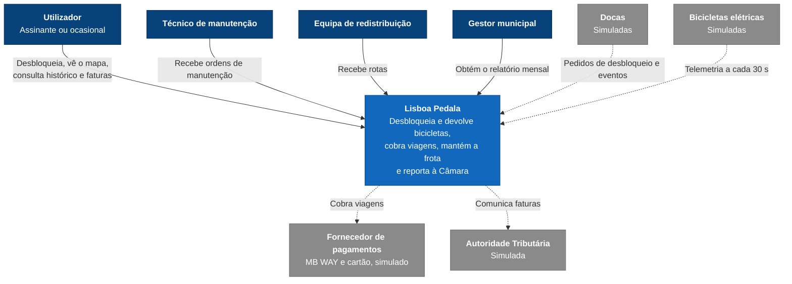

# C4 nível 1 - Contexto (IA)

Quem usa o Lisboa Pedala e com que sistemas externos comunica ([03-particionamento-e-vistas.md](../03-particionamento-e-vistas.md), secção 5).

## Legenda

A mesma legenda é usada nos três níveis.

| **Elemento**    | **Significado**                                                 |
| --------------- | --------------------------------------------------------------- |
| Azul escuro     | Pessoa                                                          |
| Azul            | Sistema Lisboa Pedala (nível 1) ou contentor (nível 2)          |
| Azul claro      | Componente (nível 3)                                            |
| Cilindro        | Base de dados                                                   |
| Cinzento        | Sistema externo (simulado neste trabalho)                       |
| Seta contínua   | Uso direto: uma pessoa usa, ou chamada de método na mesma JVM   |
| Seta tracejada  | Pela rede (REST) ou com um sistema externo                      |