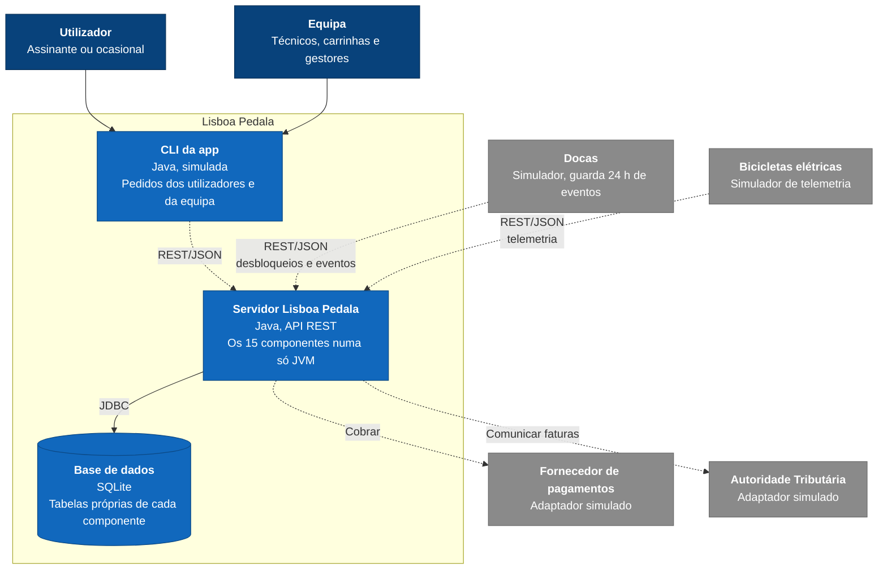

# C4 nível 2 - Contentores (IA)

Onde corre cada parte do sistema ([03-particionamento-e-vistas.md](../03-particionamento-e-vistas.md), secção 4, e [ADR-009](../adr/ADR-009.md)).

## Legenda

Igual à do [nível 1](c4-nivel1-contexto.md).

| **Elemento**    | **Significado**                                                 |
| --------------- | --------------------------------------------------------------- |
| Azul escuro     | Pessoa                                                          |
| Azul            | Contentor (algo que corre ou guarda dados)                      |
| Cilindro        | Base de dados                                                   |
| Cinzento        | Sistema externo (simulado neste trabalho)                       |
| Grupo           | Fronteira do sistema Lisboa Pedala                              |
| Seta contínua   | Uso direto: uma pessoa usa, ou acesso local                     |
| Seta tracejada  | Pela rede (REST) ou com um sistema externo                      |