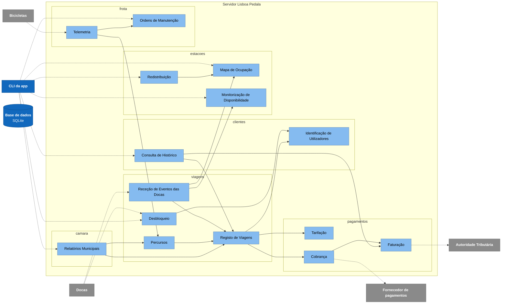

# C4 nível 3 - Componentes

Componentes dentro do Servidor Lisboa Pedala, agrupados por domínio ([ADR-008](../adr/ADR-008.md)). As setas internas são exatamente as regras allowed-to-use da vista de módulos ([03-particionamento-e-vistas.md](../03-particionamento-e-vistas.md), secção 2).

Todos os componentes usam a base de dados, cada um só nas suas tabelas. Essas setas foram omitidas para o diagrama se ler.

## Legenda

Igual à do [nível 1](c4-nivel1-contexto.md).

| **Elemento**    | **Significado**                                               |
| --------------- | ------------------------------------------------------------- |
| Azul            | Contentor                                                     |
| Azul claro      | Componente (um pacote `lisboa_pedala.<dominio>.<componente>`) |
| Cilindro        | Base de dados                                                 |
| Cinzento        | Sistema externo (simulado neste trabalho)                     |
| Grupo interno   | Domínio                                                       |
| Seta contínua   | Chamada de método na mesma JVM (A usa B)                      |
| Seta tracejada  | Pela rede (REST) ou com um sistema externo                    |