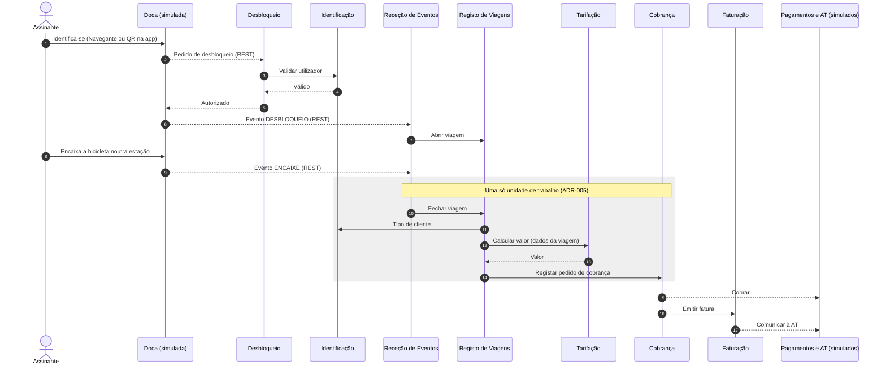

# Vista de componentes e conectores - desbloquear, devolver e cobrar (IA)

Fluxo da US1 ([03-particionamento-e-vistas.md](../03-particionamento-e-vistas.md), secção 3).
 

## Legenda

| **Elemento**           | **Significado**                                                     |
| ---------------------- | ------------------------------------------------------------------- |
| Seta contínua          | Chamada de método na mesma JVM                                      |
| Seta tracejada         | Pela rede (REST), resposta, ou comunicação com um sistema externo   |
| Caixa sombreada        | Passos que acontecem numa só unidade de trabalho (ADR-005)          |
| Número                 | Ordem obrigatória das operações (acoplamento temporal, ficheiro 02) |