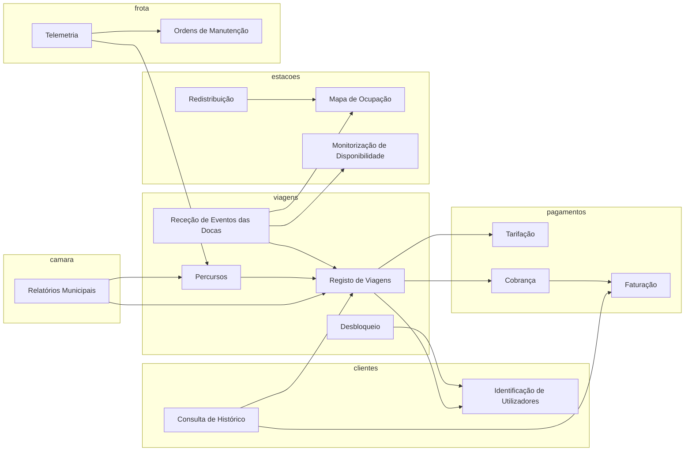

# Dependências entre componentes lógicos

Diagrama dos componentes ([02-componentes.md](02-componentes.md), secção 8).

## Legenda

| **Elemento** | **Significado**                                                         |
| ------------ | ----------------------------------------------------------------------- |
| Caixa        | Componente lógico (um pacote em `lisboa_pedala.<dominio>.<componente>`) |
| Seta A > B   | A usa B (A depende de B)                                                |
| Grupo        | Domínio a que o componente pertence (provisório)                        |
